<h1 align="center">Olá, eu sou o Gabriel Barbosa 👋</h1>

  <b>Desenvolvedor Front-end Sênior</b> · React · Next.js · React Native · TypeScript

  
  
  

### Sobre mim

- 💼 Atualmente na **ATF Credit**, responsável pela arquitetura e governança técnica do front-end de plataformas bancárias (Internet Banking e aplicativos mobile)
- 🚀 Mais de 5 anos desenvolvendo aplicações web e mobile com React, Next.js e React Native
- 🧩 Experiência com micro front-ends, offline-first, acessibilidade, SEO e performance
- ☕ Atuação complementar no back-end com Java e Python
- 🎓 Cursando Engenharia de Software na Universidade Cruzeiro do Sul
- 📍 Porto Alegre, RS

 

### Tecnologias

Também trabalho com React Native, Zustand, React Query, React Hook Form, Zod, Chakra UI e Realm.

### Estatísticas

  <picture>
    <source media="(prefers-color-scheme: dark)" srcset="https://raw.githubusercontent.com/gabrielbarbosaa/gabrielbarbosaa/output/stats-dark.svg" />
    
  </picture>
  <picture>
    <source media="(prefers-color-scheme: dark)" srcset="https://raw.githubusercontent.com/gabrielbarbosaa/gabrielbarbosaa/output/top-langs-dark.svg" />
    
  </picture>

<picture>
  <source media="(prefers-color-scheme: dark)" srcset="https://raw.githubusercontent.com/gabrielbarbosaa/gabrielbarbosaa/output/snake-dark.svg" />
  
</picture>
